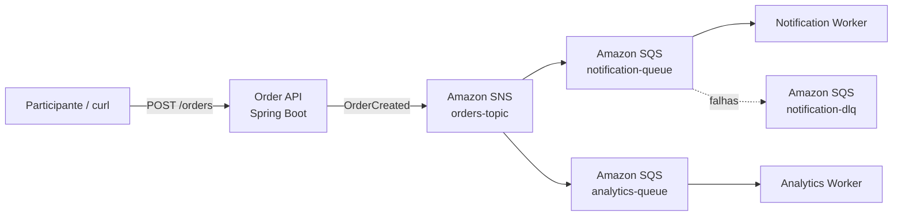

# Construa sua primeira arquitetura orientada a eventos na AWS

Workshop hands-on de 2 horas para nível iniciante/intermediário, preparado para um evento AWS.

> Todo o laboratório roda localmente com Docker + [Floci](https://floci.io/), sem necessidade de conta AWS e sem risco de cobrança.

## Objetivo

Ao final do workshop você terá construído e executado uma arquitetura orientada a eventos usando os mesmos conceitos e APIs de serviços AWS:



## O que você vai aprender

- O que é uma arquitetura orientada a eventos.
- Diferença entre comunicação síncrona e assíncrona.
- Producer, event, topic, queue e consumer.
- Fan-out com Amazon SNS + Amazon SQS.
- Por que consumidores devem ser independentes.
- Retry, Visibility Timeout e Dead Letter Queue.
- Como apontar o AWS SDK para um ambiente AWS local.
- Como levar a mesma ideia para uma conta AWS real depois do workshop.

## Stack

- Java 21
- Spring Boot 3.5.16
- AWS SDK for Java v2
- Amazon SNS
- Amazon SQS
- Floci
- Docker / Docker Compose
- Maven

## Pré-requisitos

A única instalação obrigatória é:

- Docker 20.10+
- Docker Compose v2+
- Git
- curl ou Postman/Insomnia

Java e Maven não precisam estar instalados na máquina para acompanhar o workshop: o build e a execução das aplicações são feitos pelos containers.

## Início rápido

```bash
git clone https://github.com/mdnbras/workshop-aws-cd-2026.git
cd workshop-aws-cd-2026
docker compose up --build
```

Quando os containers estiverem prontos:

```bash
curl -X POST http://localhost:8080/orders \
  -H 'Content-Type: application/json' \
  -d '{"customerEmail":"dev@aws.local","total":149.90}'
```

Você verá o mesmo evento sendo processado por dois consumidores independentes.

## Roteiro de 2 horas

| Tempo | Etapa |
|---|---|
| 00:00-00:15 | Fundamentos: síncrono x assíncrono e EDA |
| 00:15-00:30 | Subindo Floci e inspecionando os serviços locais |
| 00:30-00:50 | Lab 1 — Producer e primeiro evento |
| 00:50-01:15 | Lab 2 — SNS + SQS e fan-out |
| 01:15-01:35 | Lab 3 — Workers e consumidores independentes |
| 01:35-01:50 | Lab 4 — falha, retry e DLQ |
| 01:50-02:00 | Desafio final, recap e próximos passos |

## Material do workshop

1. [Agenda do instrutor](docs/00-agenda.md)
2. [Pré-requisitos](docs/01-pre-requisitos.md)
3. [Fundamentos de arquitetura orientada a eventos](docs/02-conceitos.md)
4. [Lab 1 — Ambiente local com Floci](docs/03-lab-1-ambiente.md)
5. [Lab 2 — Publicando o primeiro evento](docs/04-lab-2-producer.md)
6. [Lab 3 — Fan-out com SNS + SQS](docs/05-lab-3-fanout.md)
7. [Lab 4 — Retry e Dead Letter Queue](docs/06-lab-4-dlq.md)
8. [Desafios extras](docs/07-desafios.md)
9. [Cleanup e próximos passos](docs/08-cleanup.md)

## Arquitetura local

Todos os containers compartilham a mesma rede Docker. O endpoint AWS usado pelas aplicações é:

```text
http://floci:4566
```

Do host, você pode acessar o Floci em:

```text
http://localhost:4566
```

O Floci usa por padrão a conta local `000000000000` e a região `us-east-1`.

## Comandos úteis

```bash
# Ver os containers
docker compose ps

# Acompanhar todos os logs
docker compose logs -f

# Acompanhar apenas o producer
docker compose logs -f order-api

# Acompanhar apenas os consumidores
docker compose logs -f notification-worker analytics-worker

# Ver as filas
docker compose --profile tools run --rm aws-cli sqs list-queues

# Ver o tópico
docker compose --profile tools run --rm aws-cli sns list-topics

# Parar o laboratório
docker compose down

# Parar e apagar dados locais
docker compose down -v
```

## Pedido que demonstra DLQ

```bash
curl -X POST http://localhost:8080/orders \
  -H 'Content-Type: application/json' \
  -d '{"customerEmail":"fail@workshop.local","total":99.90}'
```

Esse e-mail provoca uma falha proposital apenas no `notification-worker`, permitindo visualizar retry e Dead Letter Queue sem afetar o `analytics-worker`.

## Observação importante

Floci é um emulador local compatível com APIs AWS. O objetivo do workshop é ensinar os conceitos e o fluxo de desenvolvimento sem exigir uma conta AWS. Em produção, revise IAM, redes, criptografia, observabilidade, limites, custos e disponibilidade antes de aplicar a arquitetura.

## Autor

Marcelo Brasil — `@mdnbras`
