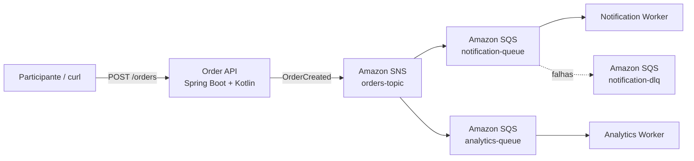

# Construa sua primeira arquitetura orientada a eventos na AWS

Workshop hands-on de 2 horas para nível iniciante/intermediário, preparado para um evento AWS.

> Todo o laboratório roda localmente com Docker + [Floci](https://floci.io/), sem necessidade de conta AWS e sem risco de cobrança.

## Objetivo

Ao final do workshop você terá construído e executado uma arquitetura orientada a eventos usando os mesmos conceitos e APIs de serviços AWS:



## O que você vai aprender

- Arquitetura orientada a eventos.
- Comunicação síncrona x assíncrona.
- Producer, event, topic, queue e consumer.
- Fan-out com SNS + SQS.
- Consumers independentes.
- Retry, Visibility Timeout e Dead Letter Queue.
- AWS SDK apontando para o Floci.
- Kotlin + Spring Boot em producer e workers.

## Stack

- Kotlin 2.2.21
- Java 21
- Spring Boot 3.5.16
- AWS SDK for Java v2
- Amazon SNS
- Amazon SQS
- Floci
- Docker / Docker Compose
- Maven

## Organização do código

```text
order-api/
  api/          # HTTP e DTOs
  application/  # caso de uso CreateOrder
  domain/       # evento OrderCreated
  messaging/    # contrato + publisher SNS
  config/       # configuração AWS SDK

event-worker/
  consumer/     # polling e ack da fila SQS
  handler/      # comportamento do consumidor
  model/        # modelo tipado do evento
  config/       # configuração AWS SDK
```

Fluxo didático:

```text
HTTP -> caso de uso -> evento -> publisher -> SNS
SQS -> consumer -> parser -> handler
```

## Branches do passo a passo

Cada etapa possui um snapshot próprio e cada laboratório começa informando a branch correta, o estado inicial e o estado final esperado.

| Branch | Etapa | Estado do projeto |
|---|---|---|
| `workshop/01-floci` | Lab 1 | Apenas Floci + AWS CLI local |
| `workshop/02-producer` | Lab 2 | SNS + Order API publicando `OrderCreated` |
| `workshop/03-fanout` | Lab 3 | SNS + duas filas SQS + subscriptions |
| `workshop/04-consumers` | Lab 4 | Consumers independentes, ainda sem DLQ |
| `workshop/05-dlq-final` | Lab 5 | Solução completa com retry e DLQ |
| `workshop/00-before-refactor` | Referência | Versão anterior à refatoração por responsabilidades |

Durante o workshop:

```bash
git switch workshop/01-floci
# execute o Lab 1

git switch workshop/02-producer
# execute o Lab 2

git switch workshop/03-fanout
# execute o Lab 3

git switch workshop/04-consumers
# execute o Lab 4

git switch workshop/05-dlq-final
# execute o Lab 5
```

> Se você se perder em qualquer etapa, volte para o início do laboratório correspondente, execute `docker compose down -v`, troque para a branch indicada e siga novamente a partir do bloco **Estado inicial**.

## Pré-requisitos

- Docker 20.10+
- Docker Compose v2+
- Git
- curl ou Postman/Insomnia

Kotlin, Java e Maven não precisam estar instalados localmente: o build é feito pelos containers.

## Início rápido — solução final

```bash
git clone https://github.com/mdnbras/workshop-aws-cd-2026.git
cd workshop-aws-cd-2026
git switch workshop/05-dlq-final
docker compose up --build
```

Teste:

```bash
curl -X POST http://localhost:8080/orders \
  -H 'Content-Type: application/json' \
  -d '{"customerEmail":"dev@aws.local","total":149.90}'
```

## Roteiro de 2 horas

| Tempo | Etapa |
|---|---|
| 00:00-00:15 | Fundamentos: síncrono x assíncrono e EDA |
| 00:15-00:30 | Lab 1 — Floci e AWS local |
| 00:30-00:50 | Lab 2 — Producer em Kotlin e primeiro evento |
| 00:50-01:10 | Lab 3 — SNS + SQS e fan-out |
| 01:10-01:30 | Lab 4 — Workers e consumidores independentes |
| 01:30-01:45 | Lab 5 — Falha, retry e DLQ |
| 01:45-02:00 | Desafio final, recap, dúvidas e próximos passos |

## Material

1. [Agenda do instrutor](docs/00-agenda.md)
2. [Pré-requisitos](docs/01-pre-requisitos.md)
3. [Fundamentos de arquitetura orientada a eventos](docs/02-conceitos.md)
4. [Lab 1 — Ambiente local com Floci](docs/03-lab-1-ambiente.md)
5. [Lab 2 — Publicando o primeiro evento](docs/04-lab-2-producer.md)
6. [Lab 3 — Fan-out com SNS + SQS](docs/05-lab-3-fanout.md)
7. [Lab 4 — Consumidores independentes](docs/06-lab-4-consumers.md)
8. [Lab 5 — Retry e Dead Letter Queue](docs/07-lab-5-dlq.md)
9. [Desafios extras](docs/07-desafios.md)
10. [Cleanup e próximos passos](docs/08-cleanup.md)

## Comandos úteis

```bash
docker compose ps
docker compose logs -f
docker compose logs -f order-api
docker compose logs -f notification-worker analytics-worker
docker compose --profile tools run --rm aws-cli sqs list-queues
docker compose --profile tools run --rm aws-cli sns list-topics
docker compose down
docker compose down -v
```

## Cenário de DLQ

Na etapa final:

```bash
curl -X POST http://localhost:8080/orders \
  -H 'Content-Type: application/json' \
  -d '{"customerEmail":"fail@workshop.local","total":99.90}'
```

A falha é proposital apenas no `notification-worker`; o `analytics-worker` continua processando e, depois das tentativas configuradas, a mensagem problemática segue para a DLQ.

## Produção real

Floci é usado apenas para desenvolvimento local e aprendizado. Em produção, revise IAM, políticas SNS/SQS, criptografia, rede, observabilidade, idempotência, limites, custos e disponibilidade.

## Autor

Marcelo Brasil — `@mdnbras`
